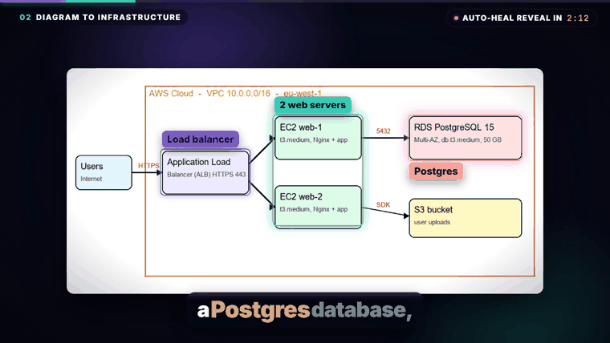
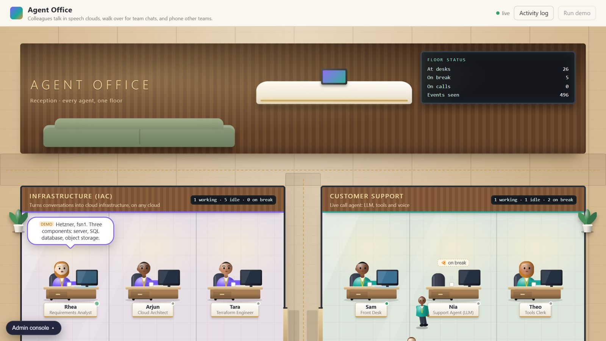
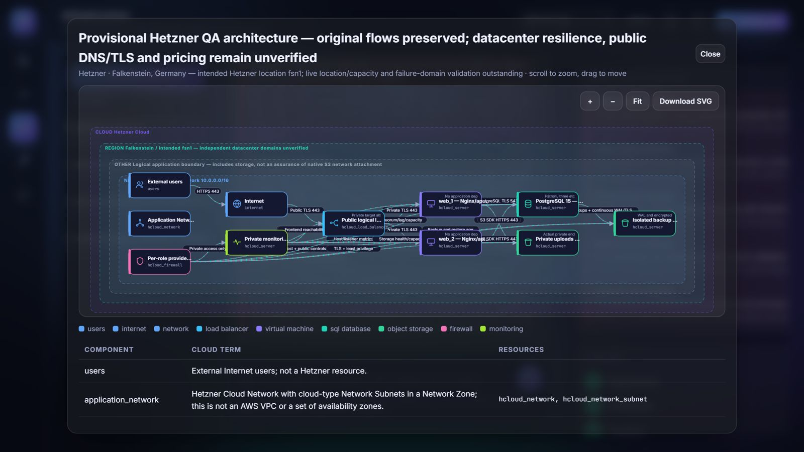
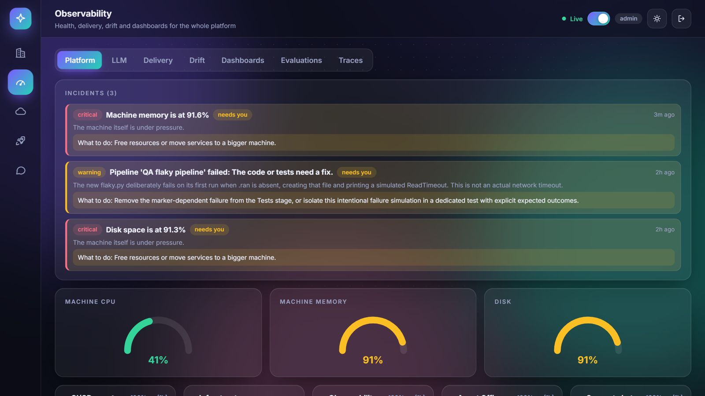
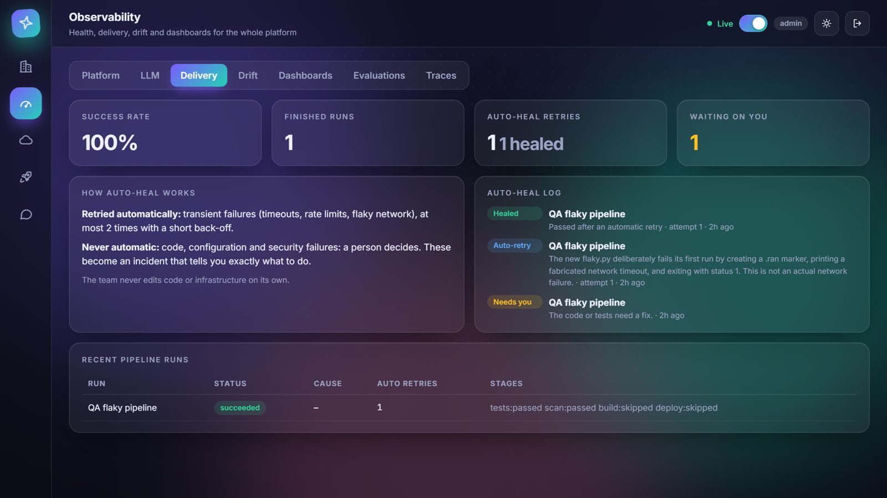
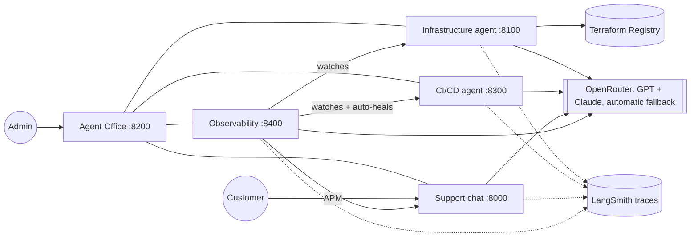

<div align="center">

# AI DevOps Office

**Every desk is an AI agent.** Drop in an architecture diagram, name any cloud, get Terraform. Then a team of agents watches it, catches drift, and heals failing CI/CD on its own.

[](https://github.com/rudra2027/ai-devops-office/actions/workflows/tests.yml)
[](LICENSE)




▶ **Full 4-minute walkthrough:** see the [latest Release](https://github.com/rudra2027/ai-devops-office/releases/latest)

</div>

## Try it in one minute, no API keys, no accounts

```bash
git clone https://github.com/rudra2027/ai-devops-office.git && cd ai-devops-office
pip install -r requirements.txt
python repo-office/shared/run_all.py --dev-auth --stub
```

Open <http://localhost:8200> and press **Continue as admin (dev mode)**.

> `--stub` replaces the language models with canned replies, so you can explore the UI, the office, the dashboards and the
> pipeline for free. It is *not* real AI. For real answers, add an OpenRouter key (see [Real models](#real-models-and-real-sign-in)) and drop `--stub`.
> `--dev-auth` accepts fake logins and is for local use only. Never run it on a server.

## What it does

| | |
|---|---|
| **Diagram to infrastructure** | Attach an architecture diagram (image, PDF, Word, draw.io, text) and name the cloud to build on. The agent reads it, tells you what it understood, asks every question it needs *once*, then writes validated Terraform and draws the live architecture. It works for clouds that have a Terraform provider, looking provider terms and resources up in the Terraform Registry instead of guessing from memory (tried live on Hetzner and AWS designs). |
| **Observability, the heart** | Real CPU, memory, disk, request rate, latency and errors for every service. Incidents say what to do. An AI dashboard designer asks all its questions first, then builds a custom dashboard using only metrics that exist. |
| **Drift watching** | Compares what is running with what you approved, scores the risk of each change, and fixes nothing without your approval. |
| **Self-healing CI/CD** | Reviews a change, runs the pipeline, and when a *transient* failure (timeout, rate limit, flaky network) hits, re-runs it automatically, at most twice. Broken code, bad config or a leaked secret is **never** retried: it stops and tells you exactly what to do. |
| **The Agent Office** | A walkable office where each agent is a colleague at a desk. Talk to any team from its cabin. Anything only you can fix shows up as a "Needs you" card. |
| **A customer support chat** | A separate, clean chat for customers: no model names, no costs, no internals. |

<p>
 
 
</p>

## How it fits together



Five FastAPI services share one small kit (`agentkit`: auth, store, LLM wrapper, streaming, APM, telemetry). Sign-in and data use Supabase, with an automatic
SQLite fallback. The services talk to each other with a shared service token, and everything an agent does can be traced.

## Honest status

Read this before you rely on it.

- **Real:** the agents, the pipeline, auto-heal (verified end to end: timeout, automatic re-run, green), metrics collection, incidents, the dashboard designer,
  diagram reading and Terraform generation, role-based access, and 100+ tests that run with no keys and no network.
- **Needs Terraform installed** for drift checks and for `plan`/`apply`. Without it the Drift tab says "cannot check" and tells you what to install.
- **Needs the Supabase SQL run** (`repo-office/shared/supabase/0001_init.sql`) before real sign-in works. Real Supabase sign-in is not exercised by the automated tests; they use `--dev-auth`.
- **Nothing is created without you:** Terraform `plan`, `approve` and `apply` are separate steps and `apply` needs your explicit approval.
- **Models vary.** Reviewers can be strict or inconsistent, so treat generated Terraform as a draft that you review.
- **In the promo video**, the screenshots and timings are real; three scenes (drift comparison, Terraform typing, the stack diagram) are labelled illustrations.
- **Default service token:** if you do not set `INGEST_TOKEN`, non-dev runs use a public default. Always set your own. `--dev-auth` generates a random one.

## Real models and real sign-in

```bash
cp .env.example .env        # then fill in OPENROUTER_API_KEY, SUPABASE_URL, SUPABASE_PUBLISHABLE_KEY, ADMIN_EMAILS
# run repo-office/shared/supabase/0001_init.sql in the Supabase SQL editor (replace the placeholder admin email first)
python repo-office/shared/run_all.py
```

Never commit `.env`. See [`repo-office/README.md`](repo-office/README.md) for roles, Redis, load tests and the full setup guide.

## Tests

```bash
pip install -r requirements-dev.txt
python repo-office/shared/run_tests.py     # every suite, stub LLM, no keys
```

## Project layout

| Folder | What it is |
|---|---|
| `repo-office/office` | The Agent Office (hub + walkable office UI), admin login gate |
| `repo-office/shared` | The shared kit (`agentkit`, UI kit, Supabase SQL), `run_all.py`, `sync.py`, load tests |
| `repo-iac-agent/iac-agent` | Infrastructure agent: requirements, architecture, Terraform, review, plan/apply, drift |
| `repo-cicd-agent/cicd-agent` | CI/CD agent: review, pipeline stages, failure classification, auto-heal hooks |
| `repo-meta-observability/meta-observability` | Observability: metrics, incidents, drift watch, dashboards, evaluations |
| `repo-support-bot/support-bot` | Customer support chat |

The shared kit is edited once in `repo-office/shared` and copied into each service with `python repo-office/shared/sync.py`.

## Contributing

Issues and PRs are very welcome, especially the ones labelled [`good first issue`](https://github.com/rudra2027/ai-devops-office/labels/good%20first%20issue).
Start with [CONTRIBUTING.md](CONTRIBUTING.md); ready-to-file starter tasks are in [docs/good-first-issues.md](docs/good-first-issues.md).

## License

[MIT](LICENSE). The promo video is built with [Remotion](https://www.remotion.dev) in a separate project that is not part of this repository; Remotion has its own license terms for companies.
